# HAKKITA

HAKKITA adalah platform yang membantu Warga Negara Indonesia menemukan program pemerintah dan layanan publik yang relevan dengan kebutuhannya. Karena informasinya tersebar di banyak situs, HAKKITA merangkum hal penting seperti instansi, periode, persyaratan, dan langkah yang perlu dilakukan, lengkap dengan rujukan resmi untuk diperiksa. Pengguna juga bisa menyimpan persiapan di Rencanaku dan bertanya lewat asisten pintar "Tanya HAKKITA". HAKKITA membantu menemukan informasi yang berpotensi sesuai; keputusan penerima tetap ada pada instansi pemerintah.

<p align="center">
  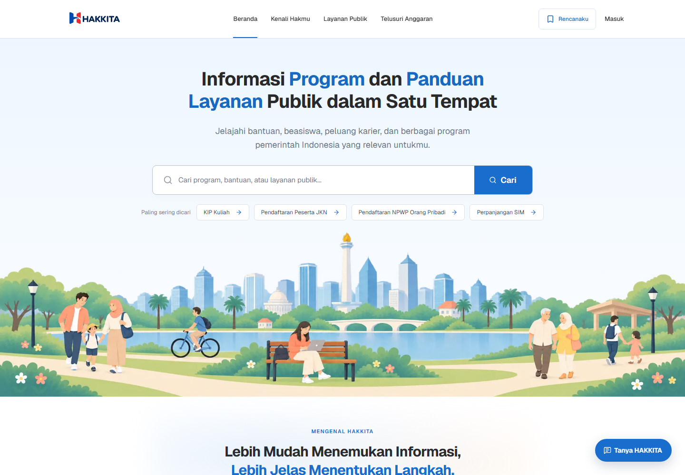
</p>

## Tim

HAKKITA dikembangkan oleh **NGGAK PUNYA NAMA TIM** dari Universitas Brawijaya.

| Anggota                 | Peran           |
| ----------------------- | --------------- |
| Vannya Ade Gunawan      | Product Manager |
| Choirotul Lutfia        | UI/UX Desainer  |
| Muhammad Wildan Zhafiri | Developer       |

## Fitur

### Kenali Hakmu

Di Kenali Hakmu, masyarakat bisa mencari program berdasarkan kata kunci, kategori, wilayah, sasaran, dan jenis manfaat. Saat membuka sebuah program, mereka dapat melihat instansi penyelenggara, periode, persyaratan, langkah pendaftaran, dan tautan sumber untuk memeriksa ketentuannya.

<p align="center">
  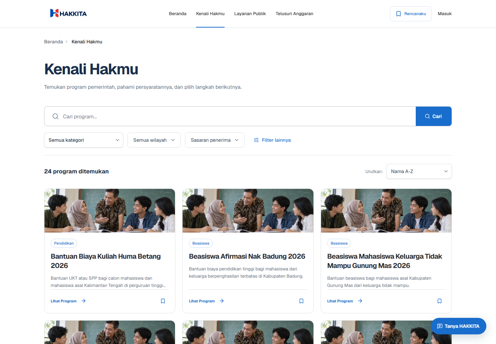
  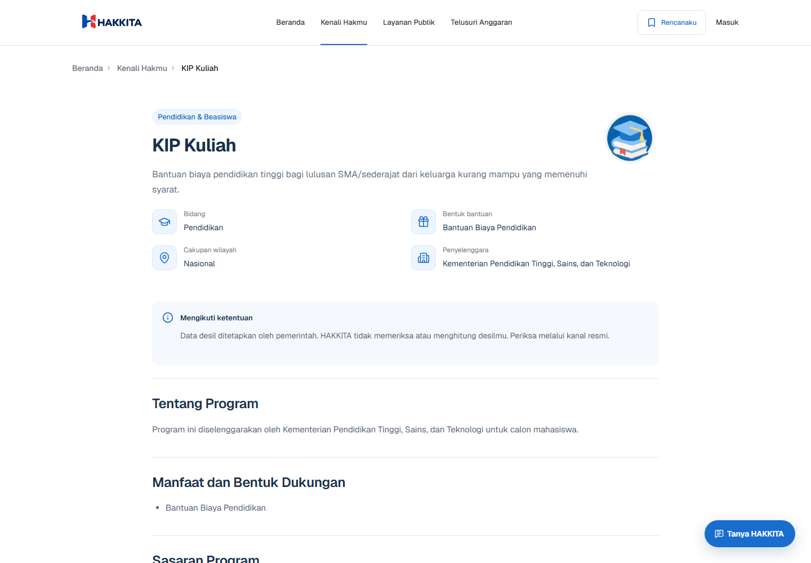
</p>

### Layanan Publik

Saat ingin mengurus dokumen atau keperluan administratif, masyarakat dapat mencari panduannya di Layanan Publik. Setiap panduan menjelaskan persyaratan dan tahapan yang perlu disiapkan sebelum proses dilanjutkan melalui kanal penyedia layanan.

<p align="center">
  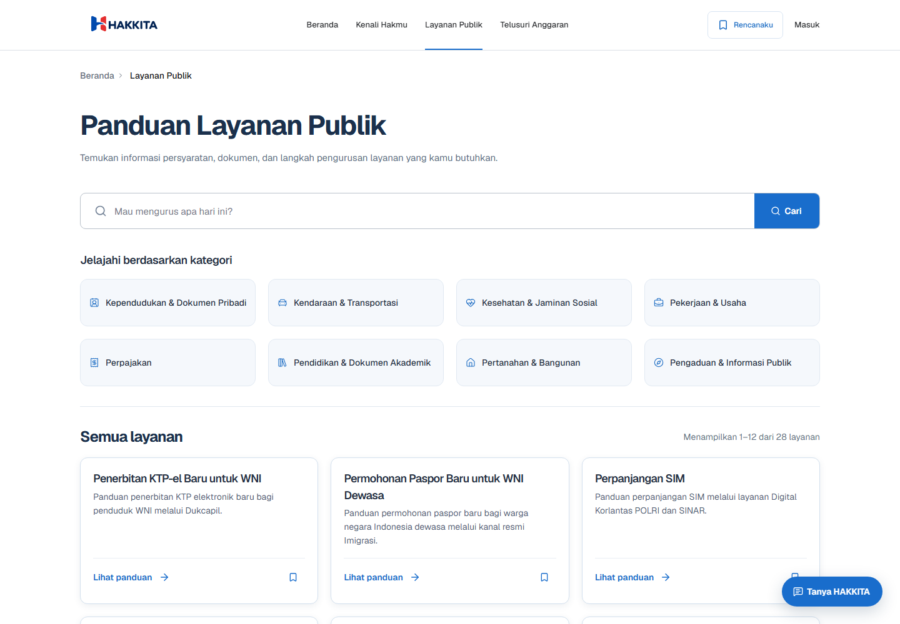
</p>

### Rencanaku

Program dan layanan yang ingin ditindaklanjuti bisa disimpan di Rencanaku. Di sana, masyarakat dapat menandai langkah persiapan yang sudah dilakukan dan bisa mendapatkan bantuan apabila terdapat kendala. Untuk program yang diikuti, pengguna juga bisa mengaktifkan email dan menerima kabar setelah admin memeriksa pembaruannya.

<p align="center">
  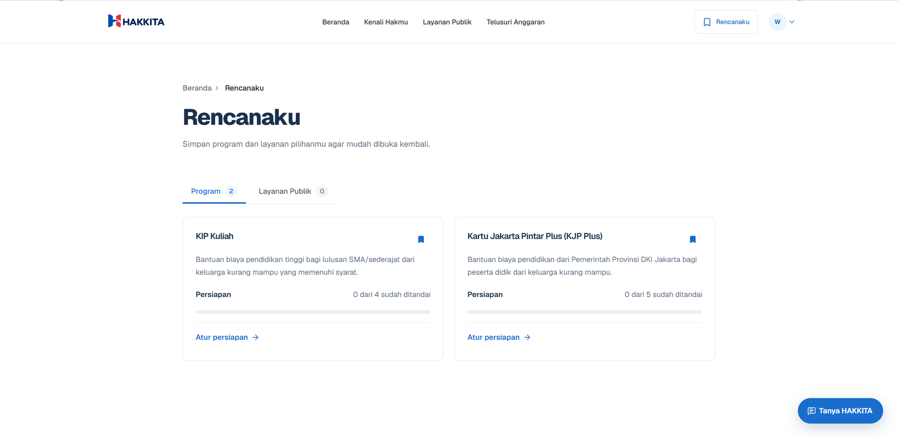
</p>

<p align="center">
  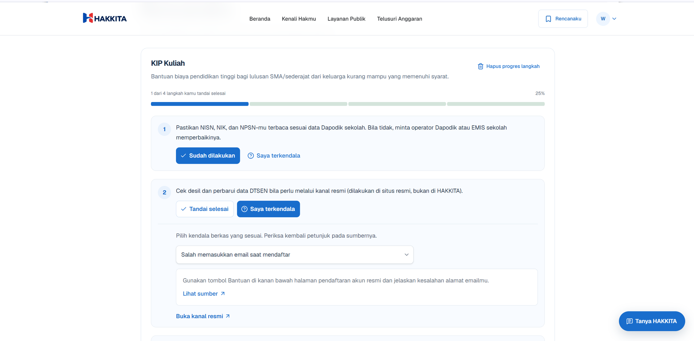
  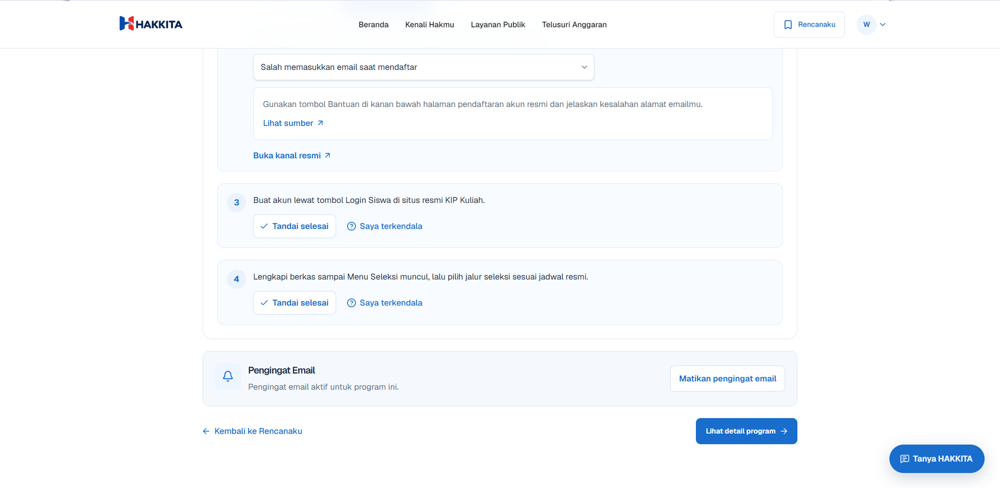
</p>

### Telusuri Anggaran

Melalui Telusuri Anggaran, masyarakat dapat menjelajahi informasi APBN dan APBD. Tab dan filter membantu memilih data yang ingin dilihat; rincian dan sumbernya dapat dibuka untuk mengetahui konteks anggaran. Data APBD mengacu pada portal resmi SIKD.

<p align="center">
  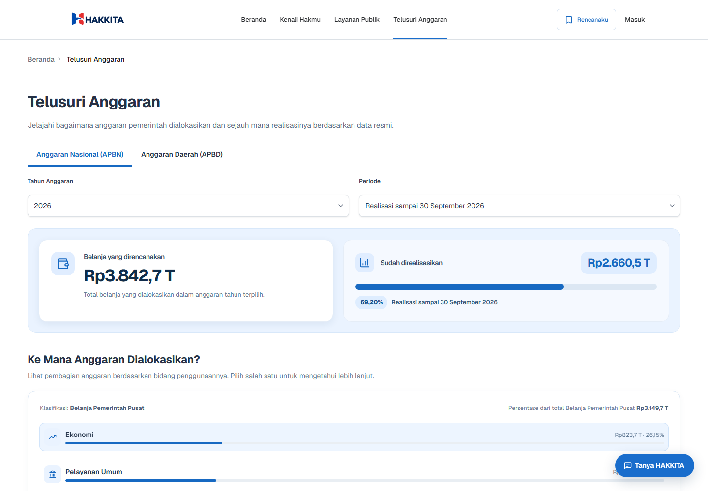
</p>

### Tanya HAKKITA

Tanya HAKKITA adalah asisten AI serbaguna untuk mencari, memahami, dan menindaklanjuti informasi publik. Ceritakan kebutuhanmu: asisten bisa menemukan program yang mungkin relevan, menjelaskan dan membandingkan persyaratan, menjawab pertanyaan tentang anggaran, atau melihat program yang tersimpan di Rencanaku. Jika informasi yang kamu cari belum ada di HAKKITA, asisten bisa menelusuri situs resmi pemerintah, membaca halaman yang relevan, lalu merangkum jawabannya beserta sumber. Jika sudah masuk, kamu juga bisa meminta asisten menyimpan program ke Rencanaku setelah menyetujui tindakan itu. Keputusan kelayakan tetap ada pada pemerintah. Jangan masukkan NIK atau data pribadi ke dalam percakapan.

<p align="center">
  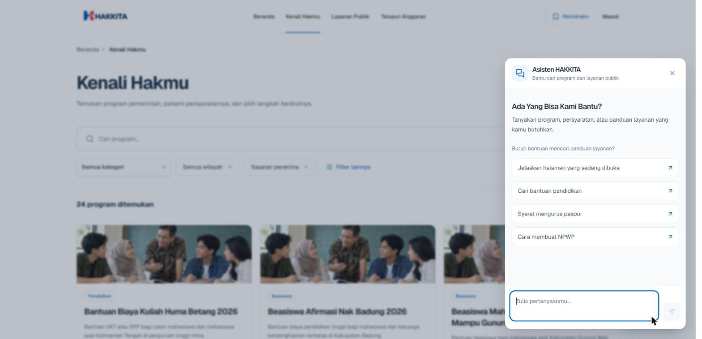
</p>

### Admin

Admin menambahkan atau memperbarui data program dan layanan. Agen AI membantu mencari program baru dan memeriksa perubahan di halaman sumber resmi yang terdaftar. Pencarian dan pemantauan bisa dijalankan manual atau dijadwalkan otomatis setiap hari, dan admin dapat mengatur apakah pemantauan aktif. Hasil pencarian langsung masuk ke Validasi Informasi untuk ditinjau: admin membuka sumber, memeriksa temuannya, lalu menyetujui atau menolak informasi tersebut. Admin juga dapat mengirim pemberitahuan kepada pengguna yang mengikuti program setelah memeriksa pratinjau emailnya.

<p align="center">
  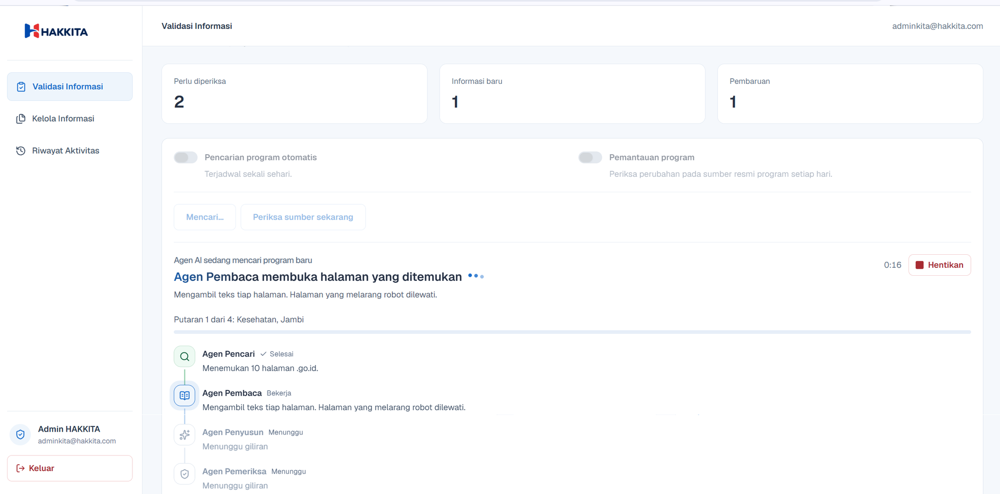
  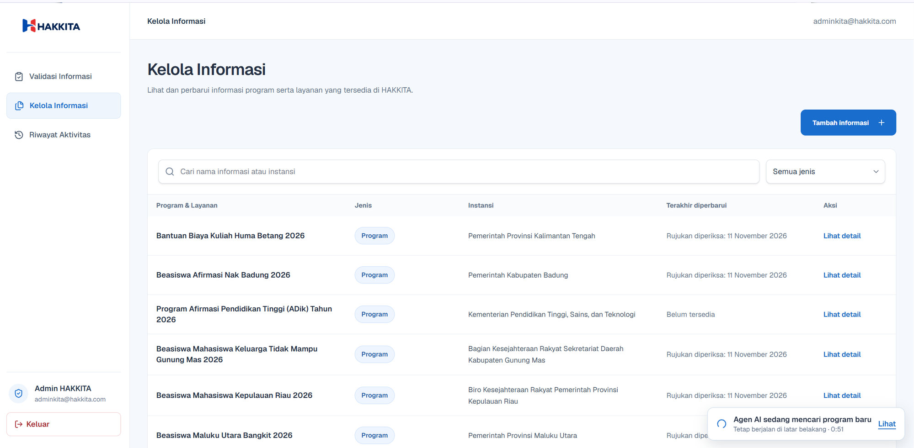
</p>

Untuk mencoba panel admin, buka [hak-kita.vercel.app/admin](https://hak-kita.vercel.app/admin) dan gunakan akun berikut:

| Email                   | Kata sandi |
| ----------------------- | ---------- |
| `adminkita@hakkita.com` | `admin123` |


Informasi publik dapat dilihat tanpa akun. Masuk diperlukan untuk menyimpan pilihan ke akun, mengikuti program, dan mengaktifkan pemberitahuan email.

## Menjalankan secara lokal

Pastikan Node.js **22.12 atau lebih baru** dan pnpm **11** sudah terpasang. Dari folder proyek, jalankan:

```bash
pnpm install
pnpm dev
```

Buka [http://localhost:3000](http://localhost:3000). Halaman publik memakai data lokal jika Supabase belum dikonfigurasi.

Untuk mencoba login, Tanya HAKKITA, email, atau fitur lain yang memakai layanan eksternal, salin `.env.example` ke `apps/web/.env.local`, lalu isi variabel yang diperlukan.

```powershell
Copy-Item .env.example apps/web/.env.local
```

Di macOS atau Linux:

```bash
cp .env.example apps/web/.env.local
```

Jangan commit `.env.local`. Kunci rahasia hanya boleh disimpan di environment server, bukan di variabel yang namanya diawali `NEXT_PUBLIC_`.

## Environment variables

Isi hanya variabel untuk fitur yang akan digunakan. `.env.example` memuat daftar lengkapnya.

| Variabel                               | Fungsi                                                                                            | Jenis             |
| -------------------------------------- | ------------------------------------------------------------------------------------------------- | ----------------- |
| `NEXT_PUBLIC_SUPABASE_URL`             | Alamat proyek Supabase                                                                            | Publik            |
| `NEXT_PUBLIC_SUPABASE_PUBLISHABLE_KEY` | Koneksi browser ke Supabase                                                                       | Publik            |
| `SUPABASE_SERVICE_ROLE_KEY`            | Akses data dari server                                                                            | Rahasia           |
| `DEMO_OFFLINE`                         | Memaksa aplikasi memakai data lokal jika diisi `true`                                             | Opsional          |
| `AI_API_KEY`                           | Kunci akses penyedia AI                                                                           | Rahasia           |
| `AI_GATEWAY_BASE_URL`                  | Alamat gateway AI                                                                                 | Konfigurasi       |
| `AI_GATEWAY_MODEL`                     | Model AI utama                                                                                    | Konfigurasi       |
| `AI_GATEWAY_FALLBACK_MODEL`            | Daftar model cadangan, dipisahkan koma                                                            | Opsional          |
| `RADAR_AI_MODEL`                       | Model AI untuk membantu memeriksa temuan informasi                                                | Opsional          |
| `TAVILY_API_KEY`                       | Pencarian kandidat program baru; tanpa key, pemeriksaan memakai sumber resmi yang sudah terdaftar | Rahasia, opsional |
| `TOOL_APPROVAL_SECRET`                 | Menandatangani persetujuan tindakan asisten                                                       | Rahasia           |
| `NEXT_PUBLIC_TURNSTILE_SITE_KEY`       | Widget perlindungan formulir di browser                                                           | Publik            |
| `TURNSTILE_SECRET_KEY`                 | Memeriksa token perlindungan formulir di server                                                   | Rahasia           |
| `RESEND_API_KEY`                       | Mengirim email pemberitahuan                                                                      | Rahasia           |
| `EMAIL_FROM`                           | Alamat pengirim yang sudah diverifikasi                                                           | Konfigurasi       |
| `HAKKITA_SITE_URL`                     | Alamat situs untuk tautan di email                                                                | Konfigurasi       |
| `CRON_SECRET`                          | Melindungi endpoint jadwal otomatis                                                               | Rahasia           |
| `HAKKITA_DATA_DIR`                     | Menentukan folder data alternatif                                                                 | Opsional          |

`AI_GATEWAY_FALLBACK_MODEL` diisi dengan ID model yang dipisahkan koma. Model dicoba sesuai urutan dan menggunakan gateway serta kunci AI yang sama. Fallback membantu jika satu model gagal; fallback tidak bisa menggantikan gateway atau kunci yang sedang tidak tersedia.

## Data dan sumber informasi

Informasi program dan layanan di HAKKITA merujuk ke situs instansi atau penyelenggara resmi. Catatan tiap program memuat sumber, tanggal pemeriksaan, dan status verifikasi agar admin maupun pengguna dapat melihat asal informasinya. File data program dan layanan ada di `data/programs/`, daftar wilayah ada di `data/wilayah/`, dan bahan rujukan Tanya HAKKITA ada di `data/knowledge/`.

Saat Supabase tersedia, aplikasi membaca data program dan layanan dari sana. Jika belum dikonfigurasi, halaman publik memakai file YAML dan JSON di repositori. Pencarian program baru dapat memakai Tavily; jika Tavily tidak dikonfigurasi, pemeriksaan tetap berjalan pada halaman sumber resmi yang sudah terdaftar. Temuan otomatis tidak langsung tampil di situs: admin memeriksa halaman sumber dan informasi yang ditemukan terlebih dahulu.

HAKKITA tidak meminta NIK atau unggahan dokumen. Hasil pencarian hanya menunjukkan kemungkinan kecocokan, bukan kepastian seseorang akan menerima program.

## Perintah proyek

| Perintah                    | Kegunaan                                             |
| --------------------------- | ---------------------------------------------------- |
| `pnpm dev`                  | Menjalankan situs untuk pengembangan.                |
| `pnpm check`                | Menjalankan lint, typecheck, tes, dan validasi data. |
| `pnpm build`                | Membuat build produksi.                              |
| `pnpm validate:data`        | Memeriksa format dan kelengkapan data.               |
| `pnpm validate:data:strict` | Memeriksa data, status verifikasi, dan masa berlaku. |
| `pnpm import:data`          | Mengimpor data program dan layanan ke Supabase.      |
| `pnpm import:knowledge`     | Mengimpor bahan rujukan Tanya HAKKITA.               |
| `pnpm knowledge:search`     | Mencoba pencarian bahan rujukan dari terminal.       |
| `pnpm add:news`             | Menambahkan kabar resmi tentang program.             |
| `pnpm email:test`           | Melihat pratinjau atau menguji email program.        |

## Teknologi

| Bagian             | Teknologi                               |
| ------------------ | --------------------------------------- |
| Aplikasi web       | Next.js 16, React 19                    |
| Bahasa pemrograman | TypeScript                              |
| Antarmuka          | HeroUI v3, Tailwind CSS 4, lucide-react |
| Data               | Supabase, YAML, JSON                    |
| Validasi dan tes   | Zod, Vitest, Testing Library            |
| Workspace          | pnpm                                    |

## Struktur kode

- `apps/web/` — aplikasi web
- `packages/schema/` — skema dan tipe data
- `packages/domain/` — aturan dan logika program
- `data/` — data program, layanan, rujukan, dan wilayah

## Lisensi

HAKKITA menggunakan [MIT License](LICENSE).
